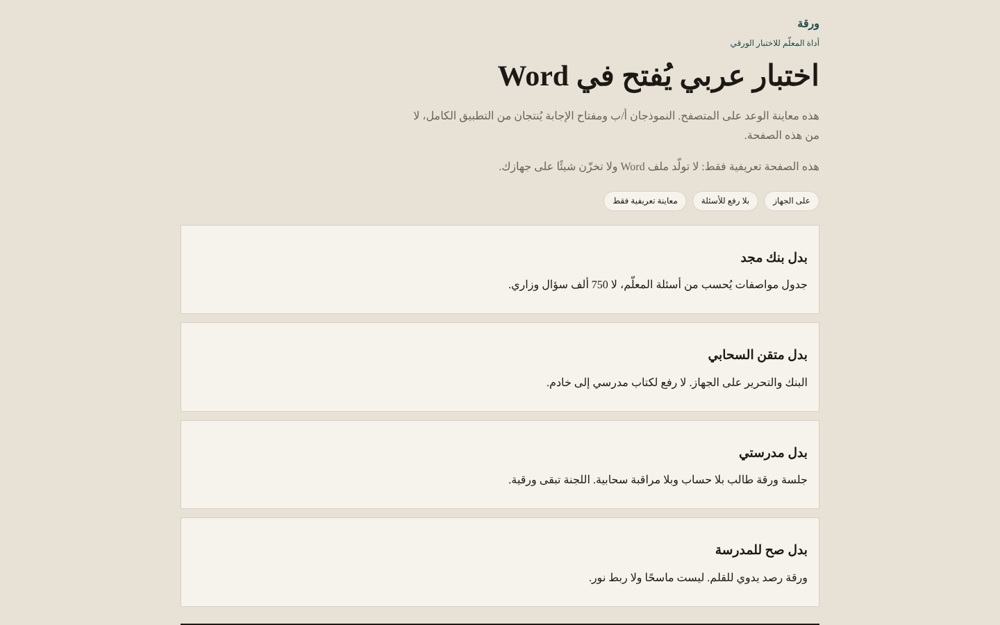
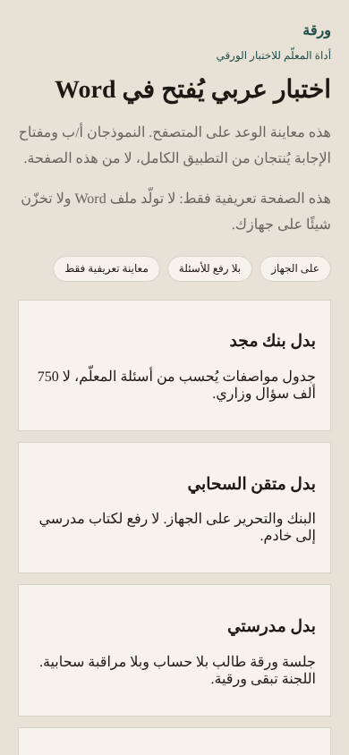

<div dir="rtl">

# 📝 ورقة · Waraqa

**أداة المعلّم للاختبار الورقي: اكتب الأسئلة مرة، وطلّع ملفًا عربيًا مرتبًا يُفتح في Word — بلا حساب وبلا رفع بيانات.**

<p>
  <a href="https://tmrsa1-ui.github.io/waraqa/"></a>
  <a href="https://github.com/tmrsa1-ui/Waraqa-Web/actions/workflows/web-face.yml"></a>
  
  
</p>

<p align="center">
  
  
</p>

## ✨ لمن؟

| | |
|---|---|
| 👩‍🏫 **للمعلم** | تجربة محلية كاملة بلا حساب. البيانات تبقى في متصفحك (`localStorage` تحت المفتاح `waraqa-v1`). |
| 🏫 **للمدارس** | حزمة تجريب لمدرسة واحدة (معلم / قسم / تقنية معلومات) عبر صفحة `#/schools`. |

## ⚠️ حدود صادقة

- لا ندّعي توافقًا كاملًا مع Word.
- ليست معتمدة من وزارة التعليم.
- لا حسابات طلاب ولا تصحيح آلي.
- البيانات المحلية غير مشفّرة في هذه اللوحة.

## 🗂️ البنية

```
public/     الصفحة العامة (تُنشر على GitHub Pages)
scripts/    فحوص الوجه العام في CI
docs/       نصوص قانونية مرجعية
```

راجع [`CHANGELOG.md`](CHANGELOG.md) لسجل الإصدارات و[`SECURITY.md`](SECURITY.md) للإبلاغ عن الثغرات.

## 📄 الرخصة

النسخ المنشورة هنا تحت رخصة [MIT](LICENSE).

</div>
